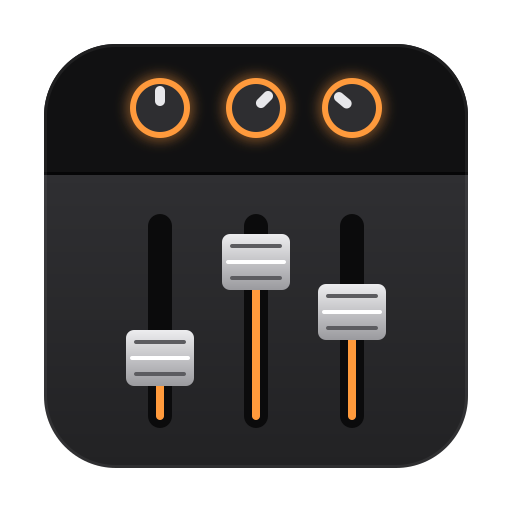
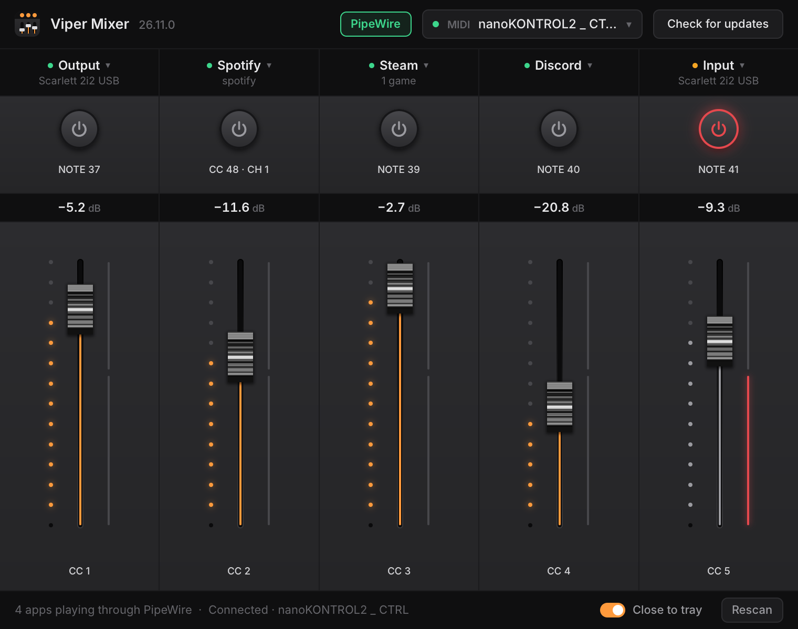

<a href="https://github.com/PolarisPyra/ViperMixer/releases/latest"></a>

# Viper Mixer



Hardware faders for your Linux desktop. Viper Mixer connects a MIDI controller to PipeWire, so each
fader sets the volume of an app, every Steam game, your output device, or your microphone, and a
button mutes it.

<br clear="left">



## Requirements

- Linux with PipeWire, and its `pw-dump` and `wpctl` tools (`pipewire-bin` on Debian and Ubuntu,
  `pipewire` on Arch and Fedora).
- A USB MIDI controller. Any controller that sends control changes or notes works.
- To build: Rust, a C compiler, `pkg-config`, and the ALSA headers (`libasound2-dev` on Debian and
  Ubuntu, `alsa-lib` on Arch).

## Run

```sh
cargo run --release
```

`viper-mixer --list-midi` prints the MIDI inputs it can see.

## Features

- **Five channel strips.** Press a strip's name plate to pick what it drives: an app that is
  playing, every Steam game at once, the default output device, or the default input. An app keeps
  its strip when it restarts; one that isn't running stays listed as inactive.
- **Learned controls.** Each strip lists its Fader and Mute controls. Press one, then move a
  fader or press a button on the controller to bind it, by channel. Right-click one to unbind it.
  A control bound to one strip comes off any other. Out of the box, faders are CC 1–5 and mutes
  are notes 37–41 on any channel.
- **Mutes follow the switch.** Down mutes the strip and up unmutes it.
- **Hardware that comes and goes.** The controller is remembered by name without ALSA's port
  numbers, so it reconnects after you unplug it, plug it into another USB port, or reboot.
  Automatic picks the first hardware input and skips MIDI Through and virtual ports. Strips on
  the output or input follow the default device when it changes.
- **Gentle on PipeWire.** A fast fader sweep sends only its latest level; a stuck `pw-dump` or
  `wpctl` is stopped after a few seconds. Opening the app doesn't unmute anything until you press
  a mute.
- **Tray.** Closing the window keeps the mixer running in the tray, unless you turn off Close to
  tray in the footer or the desktop has no tray. Opening it again brings the running window back.
- **Updates.** Shortly after it starts and then every hour, the mixer looks for a new release on
  GitHub; Check for updates in the footer looks right away. Installed as an AppImage, it downloads
  the update, checks it, and replaces itself, and a banner offers to restart into it. Built from
  source, it says a release is out and links to it. It needs `curl`.

Settings live in `~/.config/viper-mixer/config.json`, the same file the previous version used, so
assignments, levels and mute notes carry over. The older `~/.config/pipewire-mixer/config.json` is
read when that file doesn't exist yet.

## Build an AppImage

```sh
scripts/build.sh appimage
```

The output is `target/appimage/Viper-Mixer-x86_64.AppImage`, under the same name for every version.
The first run downloads linuxdeploy into `~/.cache/viper-mixer/appimage-tools/`.

## Install locally

```sh
scripts/build.sh install
```

This builds the AppImage and installs it under `~/.local` (`bin/viper-mixer`, the hicolor icon, and
`share/applications/viper-mixer.desktop`). Set `PREFIX` to install somewhere else. The
installed AppImage keeps itself up to date.

## Regenerating files

- `assets/logo.png` and `assets/tray.png` come from `assets/logo.svg`:

  ```sh
  rsvg-convert -w 512 -h 512 assets/logo.svg -o assets/logo.png
  rsvg-convert -w 64 -h 64 assets/logo.svg -o assets/tray.png
  ```

- `docs/screenshot.png` is the demo state, rendered without a window:

  ```sh
  cargo run --release -- --snap docs/screenshot.png --scene default
  ```

## Releases

Releases follow [docs/release.md](docs/release.md). In short:

- Versions are CalVer, `YY.M.N`: the two-digit year, the month, and which release of that month it
  is, from 0 (`26.11.4` → `26.11.5`, then `26.12.0` in a new month). `scripts/release.sh next`
  prints the next one; never set a version by hand.
- Every commit that changes the app ends its message with a `Changelog:` paragraph for users, such
  as `Changelog: Fixed: …`, or `Changelog: none`. The rules are in
  [docs/changelog-style.md](docs/changelog-style.md). Turn on the hook that checks it once per
  clone with `git config core.hooksPath scripts/hooks`.
- After each push to `main` that passes CI, the Release workflow keeps a **Release vYY.M.N** pull
  request up to date with the next version and its notes. Merging it with a merge commit
  (`gh pr merge release --merge`) tags the release, builds the AppImage, and creates the GitHub
  release with the notes from `CHANGELOG.md`.
- To release right away from a clean, up-to-date `main`, run `scripts/release.sh bump`.

## Project layout

| Path | What it holds |
| --- | --- |
| `src/main.rs` | Startup: the single-instance lock, the tray, and the window |
| `src/ui.rs` | The window, drawn with [Rune](https://github.com/anomalyco/rune), and its demo scenes |
| `src/mixer.rs` | The mixer's state: assignments, levels, mutes, learning, and reconnecting |
| `src/engine.rs` | Worker threads that run `pw-dump` and `wpctl` |
| `src/midi.rs` | MIDI messages, port names, and the connection to the controller |
| `src/stream.rs` | Reading apps and devices from `pw-dump` |
| `src/config.rs` | Settings, including the previous version's |
| `src/instance.rs`, `src/tray.rs` | One running copy per user, and the tray icon |
| `src/updates.rs` | Checking GitHub for releases and installing them |
| `scripts/`, `.github/`, `docs/` | Builds and releases |
